<picture>
  <source media="(prefers-color-scheme: dark)" srcset="assets/plate-dark.svg" />
  <source media="(prefers-color-scheme: light)" srcset="assets/plate-light.svg" />
  
</picture>

<br />

Building and maintaining internal systems at **Hospital Miri, Jabatan Kesihatan Sarawak**.
This account is dedicated to hospital engineering work — reliable daily operations, strict data privacy, and clean, maintainable software.

[valeport.space](https://www.valeport.space) &nbsp;/&nbsp; [linkedin](https://www.linkedin.com/in/valentine-a-a278a7254)

---

### Scope

| No. | Area | Focus |
| :--- | :--- | :--- |
| `01` | **Maintain** | Bug fixes, updates, and keeping internal systems running reliably every day. |
| `02` | **Build** | Web apps and backend services supporting daily clinical and hospital workflows. |
| `03` | **Report** | Data pipelines and dashboards turning operational records into usable insight. |

### Stack

```text
backend   Python / FastAPI / Flask / Node.js
frontend  TypeScript / JavaScript / React / Next.js / Tailwind CSS
data      PostgreSQL / MongoDB / Supabase
infra     Docker / Linux / Git / GitHub / VS Code
```

### Principles

`01` &nbsp; **Reliability first** — hospital staff depend on these systems every day.

`02` &nbsp; **Data privacy by default** — no patient data in repositories, ever.

`03` &nbsp; **Small, reviewed changes** — documented and straightforward to roll back.

---

<sub>For collaboration or system enquiries, reach me on <a href="https://www.linkedin.com/in/valentine-a-a278a7254">LinkedIn</a> or <a href="https://www.valeport.space">valeport.space</a>.</sub>
