<picture>
  <source media="(prefers-color-scheme: dark)" srcset="assets/plate-dark.svg" />
  <source media="(prefers-color-scheme: light)" srcset="assets/plate-light.svg" />
  
</picture>

 

Developing and maintaining internal systems at **Hospital Miri, Jabatan Kesihatan Sarawak**.

[valeport.space](https://www.valeport.space) &nbsp;/&nbsp; [linkedin](https://www.linkedin.com/in/valentine-a-a278a7254)

 

<picture>
  <source media="(prefers-color-scheme: dark)" srcset="assets/spec-dark.svg" />
  <source media="(prefers-color-scheme: light)" srcset="assets/spec-light.svg" />
  
</picture>

 

HM-JKS / Miri, Sarawak — for collaboration or system enquiries, connect on <a href="https://www.linkedin.com/in/valentine-a-a278a7254">LinkedIn</a> or visit <a href="https://www.valeport.space">valeport.space</a>.
