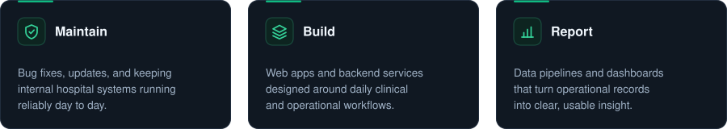
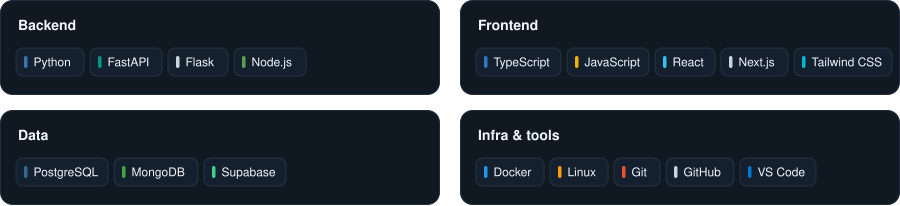

<picture>
  <source media="(prefers-color-scheme: dark)" srcset="assets/banner-dark.svg" />
  <source media="(prefers-color-scheme: light)" srcset="assets/banner-light.svg" />
  
</picture>

  <a href="https://www.valeport.space">
    <picture>
      <source media="(prefers-color-scheme: dark)" srcset="assets/btn-portfolio-dark.svg" />
      <source media="(prefers-color-scheme: light)" srcset="assets/btn-portfolio-light.svg" />
      
    </picture>
  </a>
  &nbsp;
  <a href="https://www.linkedin.com/in/valentine-a-a278a7254">
    <picture>
      <source media="(prefers-color-scheme: dark)" srcset="assets/btn-linkedin-dark.svg" />
      <source media="(prefers-color-scheme: light)" srcset="assets/btn-linkedin-light.svg" />
      
    </picture>
  </a>

### About this account

I'm a software engineer at **Hospital Miri, Jabatan Kesihatan Sarawak**. This account is dedicated to developing and maintaining the hospital's internal systems — focused on dependable daily operations, strict data privacy, and maintainable software.

<picture>
  <source media="(prefers-color-scheme: dark)" srcset="assets/focus-dark.svg" />
  <source media="(prefers-color-scheme: light)" srcset="assets/focus-light.svg" />
  
</picture>

### Tech stack

<picture>
  <source media="(prefers-color-scheme: dark)" srcset="assets/stack-dark.svg" />
  <source media="(prefers-color-scheme: light)" srcset="assets/stack-light.svg" />
  
</picture>

### Working principles

| # | Principle | Practice |
| :--- | :--- | :--- |
| `01` | **Reliability first** | Hospital staff depend on these systems every day. |
| `02` | **Data privacy by default** | No patient data in repositories, ever. |
| `03` | **Small, reviewed changes** | Documented, testable, and easy to roll back. |

---

For collaboration or system enquiries, connect on <a href="https://www.linkedin.com/in/valentine-a-a278a7254">LinkedIn</a> or visit <a href="https://www.valeport.space">valeport.space</a>.
