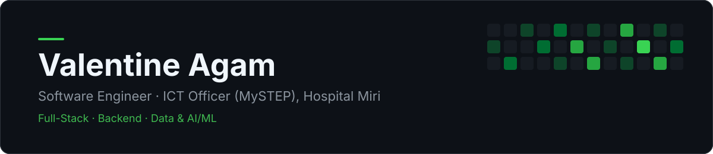

  

  <a href="https://www.linkedin.com/in/valentine-a-a278a7254"><b>LinkedIn</b></a>
  &nbsp;·&nbsp;
  <a href="https://www.valeport.space"><b>Portfolio</b></a>
  &nbsp;·&nbsp;
  📍 Sarawak, Malaysia

---

### 🏥 About this account

I'm a software engineer at **Hospital Miri, Jabatan Kesihatan Sarawak**.
This account is where I develop and maintain the hospital's internal systems.

<table>
  <tr>
    <td width="33%" valign="top">
      <b>🛠️ Maintain</b> 
      Bug fixes, updates and keeping internal systems running reliably.
    </td>
    <td width="33%" valign="top">
      <b>🚀 Build</b> 
      Web apps and backend services that support daily hospital operations.
    </td>
    <td width="33%" valign="top">
      <b>📊 Report</b> 
      Data pipelines and dashboards that turn records into usable insight.
    </td>
  </tr>
</table>

### 🧰 Tech stack

| Area | Tools |
|---|---|
| **Backend** |  |
| **Frontend** |  |
| **Data** |  |
| **Infra & tools** |  |

### 🤝 Working principles

- **Reliability first:** hospital staff depend on these systems every day.
- **Data privacy by default:** no patient data in repositories, ever.
- **Small, reviewed changes:** documented and easy to roll back.

---

  For collaboration or system enquiries, reach me on <a href="https://www.linkedin.com/in/valentine-a-a278a7254">LinkedIn</a>.

